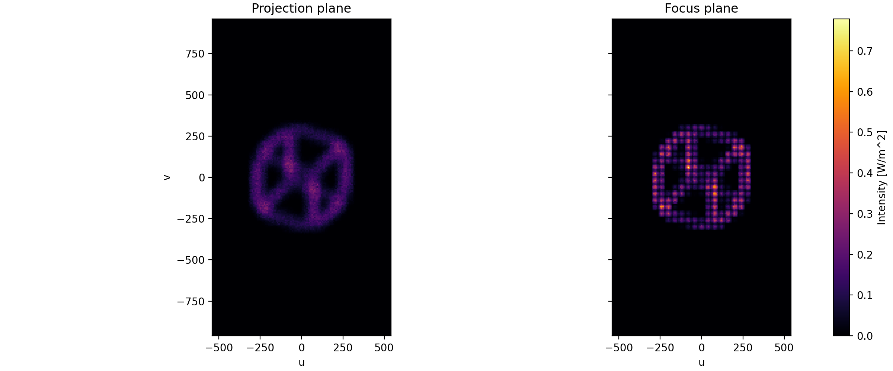
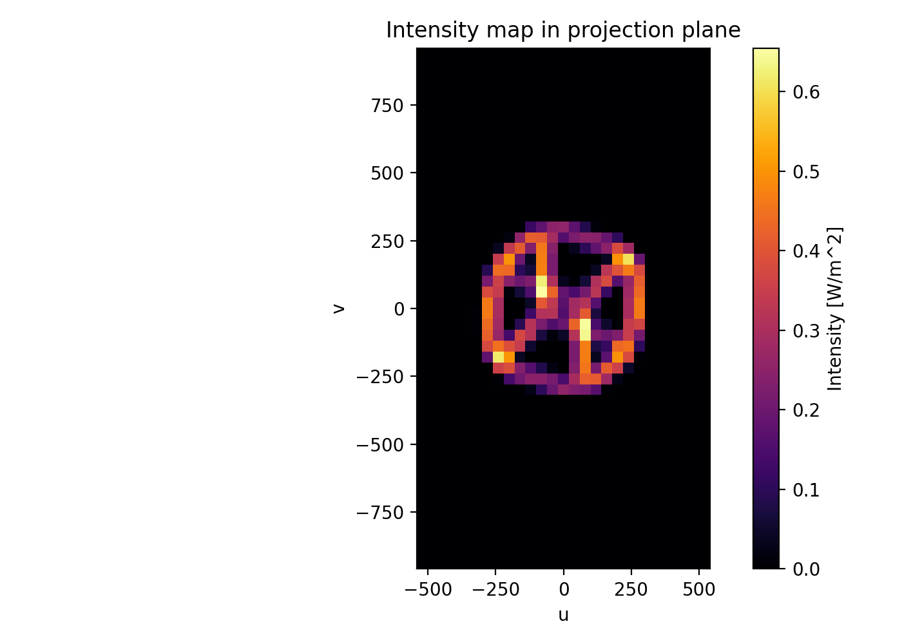
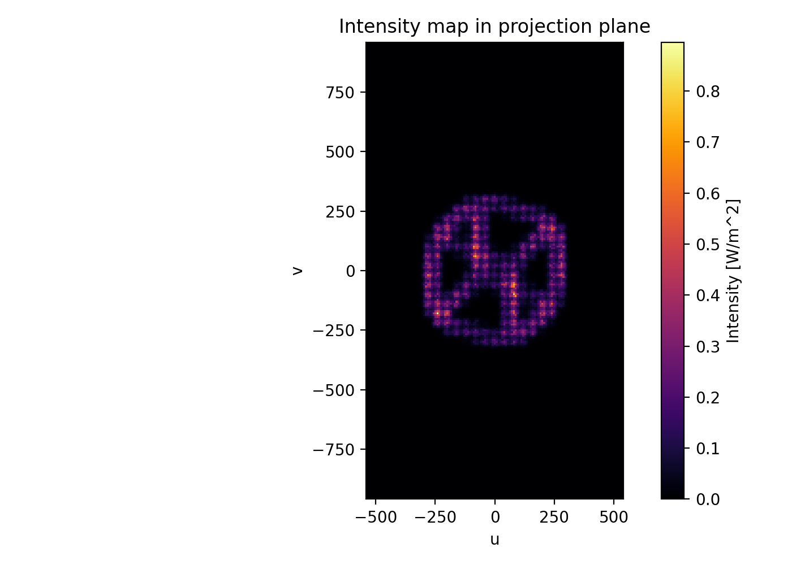
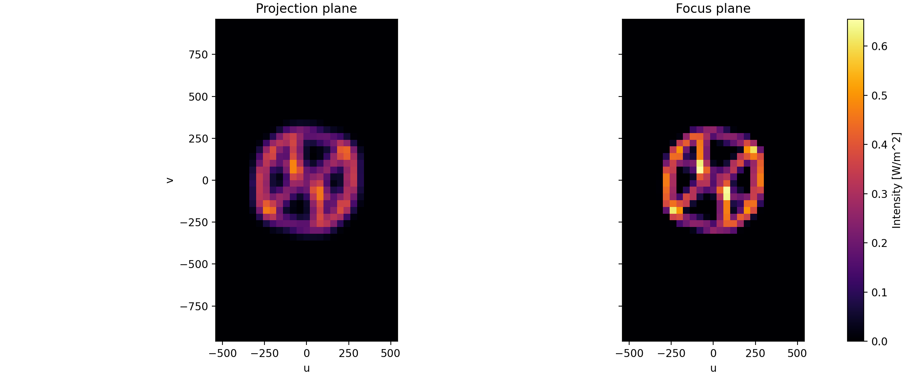
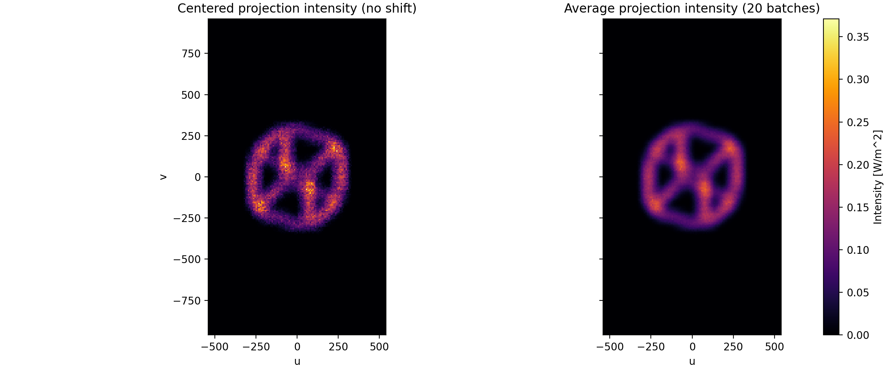
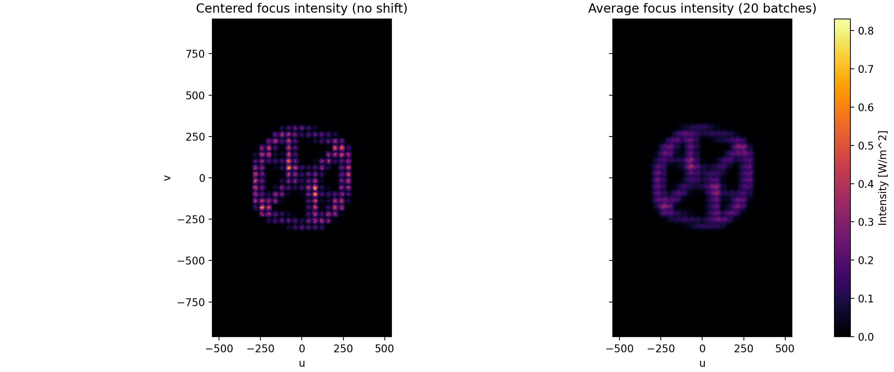

# DMDprojector-raydiscretizer

Turns DMD projector images (PNG frames) into ray files (`.ry`) for
geometric-optics / GRIN ray tracing (e.g. [MIRAGE](https://github.com/Mirage-Optics)).

Every lit DMD pixel becomes a bundle of rays. The pixel's grayscale value sets
its power, and the TOML config sets the projector optics: pixel pitch,
rays per pixel, collimated or focused light, flat or Gaussian pixels.



## Quick start: PNG → rays

```bash
python3 -m pip install -r requirements.txt
python3 projectionImageGen.py --config examples/png2ry/png_mask_frame_0001_flat_1rpp.toml
```

This converts `examples/png2ry/frames/frame_0001.png` into
`examples/png2ry/output/png_mask_frame_0001_flat_1rpp.ry`.

### Minimal PNG config

```toml
[projection]
width  = 1080.0            # projection plane size (simulation length units)
height = 1920.0
axis = "y"                 # propagation axis
direction = 1              # +1 / -1 along that axis
focus_plane_position  = 0.0
source_plane_position = -2000.0
center = [0.0, 0.0]

[emission]
origin_type = "pixelated"
base_intensity = 1.0       # intensity of a white (255) pixel, W/m^2

[focus]
mode = "collimated"        # or "focused" + cone_half_angle_deg

[mask]
type = "png"
png_path = "./frames/frame_0001.png"   # single frame, or:
# png_folder = "./frames"              # a whole projection sequence
# frame_step = 6                       # use every 6th frame
pixel_pitch = [10.0, 10.0] # size of one DMD pixel on the projection plane

[pixels]
rays_per_pixel = 1
intensity_mode = "flat"    # or "gaussian"

[output]
output_folder = "./output"
output_filename = "frame.ry"   # ignored in folder mode (frame_0007.png -> frame_0007.ry)
rays_only = true               # skip debug PNG/NPZ maps
seed = 42
```

Relative paths are resolved from the TOML file's location.

### How a PNG is read

- **Grayscale = power.** Black pixels emit nothing. Other pixels emit with
  intensity `base_intensity × gray/255`.
- **Centered.** The image center sits at the projection-plane center
  (`projection.center` + `mask.offset`).
- **Pitch sets the scale.** Each PNG pixel is a cell of size
  `mask.pixel_pitch`. For PNGs, `pixels.size` and `mask.pixel_dimension` are
  ignored and the cell size equals the pitch.
- **Resolution matching.** The target grid is
  `projection.width / pitch_u × projection.height / pitch_v`:
  - grid equals the PNG size → used 1:1;
  - grid smaller than the PNG → each target pixel takes the mean gray value of
    its source block (box downsampling);
  - grid larger than the PNG → error (no upsampling).
- **Frame sequences.** `mask.png_folder` + `mask.frame_step` handle TVAM
  projection stacks (e.g. VAMToolbox/TOMO output). You get one `.ry` per frame,
  named after the frame.

PNG examples in [`examples/png2ry/`](examples/png2ry):

| Config | What it shows |
| --- | --- |
| [`png_mask_frame_0001_flat_1rpp.toml`](examples/png2ry/png_mask_frame_0001_flat_1rpp.toml) | one frame, 1 ray per pixel, flat, collimated |
| [`png_folder_every6_rays_only.toml`](examples/png2ry/png_folder_every6_rays_only.toml) | whole folder, every 6th frame, rays only |
| [`full_fidelitypng_mask_frame_0001_flat_1rpp.toml`](examples/png2ry/full_fidelitypng_mask_frame_0001_flat_1rpp.toml) | one frame, Gaussian pixels, 250 rays/pixel, focused 8° cone |

## Pixel emission modes

These options control how each lit pixel turns into rays.

| Key | Options | Effect |
| --- | --- | --- |
| `pixels.intensity_mode` | `flat`, `gaussian` | Uniform pixel, or a Gaussian whose peak equals the pixel intensity (width from `pixels.size`, `gaussian_size_type = "1/e2_diameter"`). |
| `pixels.rays_per_pixel` | int | Rays drawn uniformly over the pixel. Each ray carries `I(x)·A/N`. |
| `pixels.sample_size` | `[u, v]` or scalar | Area rays are drawn from. Defaults to the pixel size. Set it larger to capture Gaussian tails, smaller to sample only the core. |
| `focus.mode` | `collimated`, `focused` | Rays parallel to the axis, or sampled in a cone of `cone_half_angle_deg` around the focus point and traced back to the source plane. |
| `pixels.activation_mode` | `center`, `antialiased` | Analytic masks only (see below): pixel on/off by its center, or scaled by its in-mask area fraction (`aa_samples`). |
| `pixels.projector_shift_max_pixels` | `[u, v]` or scalar | Random in-plane projector jitter per batch, in pixel pitches (the mask stays fixed). |
| `output.normalize_batch_energy_to_mask_power` | bool | Rescale so batch energy equals `base_intensity × mask area` exactly. |
| `output.batch_count`, `output.save_average_maps` | int, bool | Generate several batches and optionally save averaged intensity maps. |

### Examples on the same PNG

All configs in [`examples/png_modes/`](examples/png_modes) use
`examples/png2ry/frames/frame_0001.png` at a coarse 40-unit pitch
(27 × 48 DMD pixels), so individual pixels are visible. Run one with
`python3 projectionImageGen.py --config examples/png_modes/<name>.toml`.

| | |
| --- | --- |
| **Flat, collimated**<br>[png_flat_collimated.toml](examples/png_modes/png_flat_collimated.toml)<br> | **Gaussian, collimated**<br>[png_gaussian_collimated.toml](examples/png_modes/png_gaussian_collimated.toml)<br> |
| **Gaussian, `sample_size` = 2 × pitch** (keeps the Gaussian tails)<br>[png_gaussian_wide_sampling.toml](examples/png_modes/png_gaussian_wide_sampling.toml)<br> | |

Focused emission, 8° cone (left: projection plane, right: focus plane, where
the DMD image is sharp):

- **Flat**: [png_flat_focused.toml](examples/png_modes/png_flat_focused.toml)
  
- **Gaussian**: [png_gaussian_focused.toml](examples/png_modes/png_gaussian_focused.toml)
  

Projector jitter (±2 pitches), 20 batches averaged (left: unshifted batch,
right: average): [png_gaussian_focused_jitter.toml](examples/png_modes/png_gaussian_focused_jitter.toml)




## Optional: analytic masks

For quick tests without an image, swap the PNG for a built-in shape:

```toml
[mask]
type = "circle"            # rectangle | circle | triangle | annulus | png
radius = 200.0
```

With analytic masks, `pixels.activation_mode = "antialiased"` scales edge
pixels by their in-mask area. `emission.origin_type = "continuous"`
(`[continuous] n_rays = ...`) skips pixels entirely and samples straight from
the shape. [`projectionImageGen.example.toml`](projectionImageGen.example.toml)
documents every key, and [`examples/raygen/`](examples/raygen) has more cases.

| | |
| --- | --- |
| **Triangle, center activation**<br>[triangle_pixelated_flat.toml](examples/raygen/triangle_pixelated_flat.toml)<br> | **Circle, antialiased**<br>[circle_antialiased_flat.toml](examples/raygen/circle_antialiased_flat.toml)<br> |
| **Triangle, continuous sampling**<br>[triangle_continuous.toml](examples/raygen/triangle_continuous.toml)<br> | **Annulus, Gaussian, focused**<br>[annulus_gaussian_antialiased_focused.toml](examples/raygen/annulus_gaussian_antialiased_focused.toml)<br> |

## Outputs

- `<name>.ry`: the ray file (always).
- Unless `rays_only = true`: an intensity map next to each `.ry`, either
  `<stem>_projection.png` (collimated) or `<stem>_projection_focus.png`
  (focused; both planes on shared axes and color scale).
- With `save_average_maps = true`: `<stem>_projection_average.png/.npz`, plus
  `<stem>_focus_average.png/.npz` when focused.
- Map binning: flat pixels use 1 bin per pixel. Gaussian pixels use
  `bins_per_pixel` (default 5×5). Continuous mode picks bins from ray density.

## `.ry` format (ray file v1)

```text
# ray file v1
# original_area: <area>
# original_intensity: <intensity>
# format:
# nrays
# ox oy oz dx dy dz energy
<nRays>
ox oy oz dx dy dz energy
...
```

To parse: skip lines starting with `#`, read the ray count, then one row per
ray (origin, direction, energy). The `original_area` and `original_intensity`
metadata record the mask area and configured base intensity used to generate
the file.

## Running

```bash
python3 projectionImageGen.py --config path/to/case.raygen.toml
```

To call it from any directory, add the repo to `PATH` (e.g. in `~/.bashrc`):

```bash
export PATH="$PATH:$HOME/path/to/DMDprojector-raydiscretizer"
chmod +x "$HOME/path/to/DMDprojector-raydiscretizer/projectionImageGen.py"   # once
```

Rebuild all gallery examples:

```bash
for cfg in examples/png_modes/*.toml examples/raygen/*.toml; do python3 projectionImageGen.py --config "$cfg"; done
```
